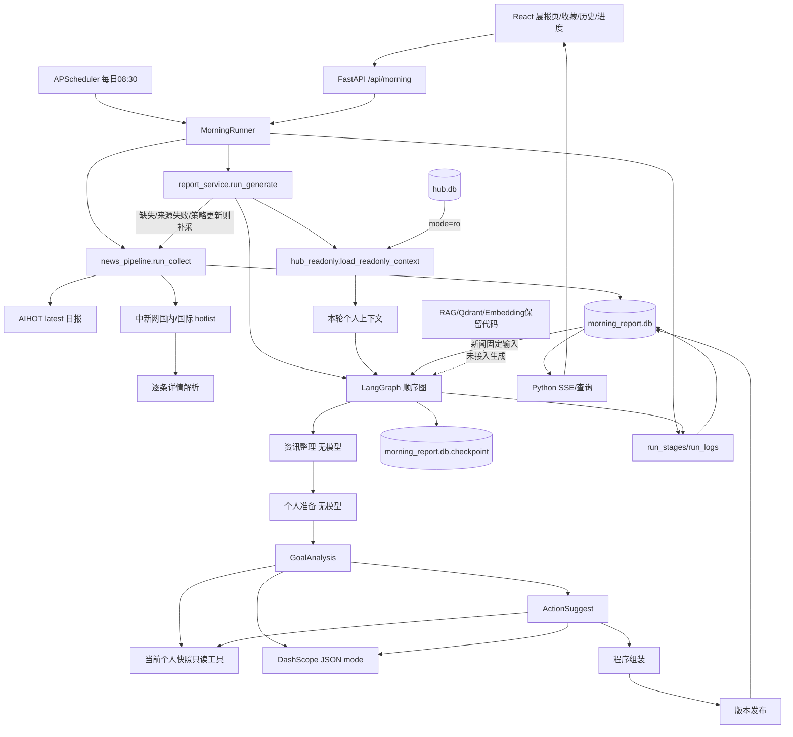
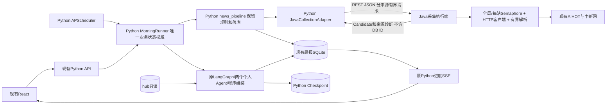

# 晨报模块 Java 化可行性审计与混合架构重构设计

> 审计日期：2026-11-16（Asia/Shanghai）。状态：候选设计，未批准实施。
> 范围：读取当前代码、配置、Schema、测试与历史；仅新增本文档。不代表修改 PRD 或将未来需求加入当前计划。

## 1. 结论与事实边界

**结论：可以开展有界的 Java 采集执行原型，不建议现在整体重构晨报。**最合理边界是来源获取、详情提取和有界并发执行；Python 继续拥有工作流、业务任务、业务规则和全部现有数据库写入权。Java 第一版没有数据库，没有每日调度，不调用模型。

当前系统没有高并发业务压力或 Python 性能瓶颈的测量证据。Java 的可论证价值是类型契约、执行资源治理、独立故障边界及企业后端学习，而非语言必然更快。连接复用、有界并发和超时治理也能在 Python 实现，必须纳入对照。

**与 Agent 的联系必须如实描述：当前新闻不进入任何分析 Agent，采集也不是 Agent Tool。**迁移采集层只能形成“Python Agent 工作流所在应用 + Java 确定性执行端”，不能宣称“Agent 根据新闻动态规划 Java 工具调用”。如果强制要求后者，当前保行为迁移不能满足；需要另行批准新闻专题研究等新业务，不能借重构恢复已删除的 TechResearch。

### 1.1 审计依据与版本

| 项目 | 本次观察 |
| --- | --- |
| 工作区/身份 | `E:/wechat-LangGraph`，`main`，main Agent |
| HEAD | `9cf309320977155d51cf6b0d5e834d3f1bc1c8fc`，2026-11-14，新增浏览器启动页与分阶段加载 |
| 未提交修改 | 开始时 21 个已跟踪文件变更，另有经验库、存储盘点等未跟踪文件；不覆盖、不暂存、不提交 |
| 晨报相关脏文件 | `config.py`、`graph/prompts.py`、`graph/workflow.py`、两个测试；共享入口 `app/main.py` 和文档也有变更 |
| 信息优先级 | 工作区代码 > 配置/Schema/API/测试 > 当前文档 > Git > 历史聊天 |
| 运行时配置 | 未读取用户密钥文件，未调用正在运行的服务；默认值不等于进程实际生效值 |
| 数据读取 | 仅以 SQLite `mode=ro` + `PRAGMA query_only=ON` 检查本工作区两库及 Checkpoint 的表/列、晨报迁移版本，不读取私人正文 |
| 未做事项 | 无真实采集/模型调用；无生产迁移、数据改写、Qdrant 操作；无跨工作区修改 |

本报告引用路径均相对仓库根，关键函数用于精确定位，避免行号随未提交修改漂移。发现已有不一致仅记录，不修复。目标架构是设计而非当前事实。

### 1.2 规范边界

`AGENTS.md` §3.4 禁止未经讨论增加服务与重依赖；本次用户明确要求评估双进程设计，故可以讨论 Java 服务，但**没有实际实施授权**。未来实施需明确接受双进程这一架构例外，并确定归属工作区；不自行修改规范或另一个工作区。主库 Alembic、晨报独立迁移和数据隔离规则全部保留。

## 2. 项目状态、技术栈与运行入口

| 层 | 当前代码与职责 |
| --- | --- |
| Python | Conda `agent`；本次解释器 `D:/miniconda/envs/agent/python.exe`，实际 3.13.18 |
| 后端依赖 | `requirements.txt`：FastAPI 0.135.1、SQLAlchemy 2.0.48、httpx 0.28.1、LangChain 1.2.12、LangGraph 1.1.2、checkpoint-sqlite 3.1.3、APScheduler 3.11.3；按文件锁定，不升级 |
| 前端 | `web/package.json`：React 18、TypeScript 5、Vite 5、TanStack Query 5、Tailwind、Radix；Vitest + Testing Library |
| 目录 | `app/api,services,adapters,models,tasks,wechat_agent,morning_report`；晨报自包含 `api/services/adapters/graph/models.py/db.py/config.py`；`web/src`；`launcher`；`tests`；`alembic` |
| 入口 | `launcher/launch.py:resolve_python_cmd` → `uvicorn --factory app.main:create_app`，默认 `127.0.0.1:8620`；开发前端 5173 代理 `/api` |
| 装配 | `app/main.py:create_app/load_module/_init_morning_report`：首页优先，晨报异步初始化、恢复旧任务后启动调度，未就绪 API 返回 503/module_loading 或 module_failed |
| 静态资源 | FastAPI 托管 `web/dist`；当前工作区新增 HTML no-cache 行为，与 Java 设计无关 |
| 测试 | `tests/test_morning*.py` 共 26 个文件，另有 8 个晨报前端测试文件；排除本地Qdrant文件后收集192项，函数数不等于参数化用例数，不据此声称覆盖率达标 |

近期相关提交：`b576bca` 收藏新闻；`c163021` 确定性组装/展示快照；`a5f0648` 决策、交互、JSON；`81f765a` JSON mode 不支持错误；`8227458` 热榜与移除事实校验；`83bf23e/2feed29` 终态与取消；`78ddbf1` 历史阶段 4；`66dec57` 历史采集阶段。历史快照只用于差异核对。

## 3. 当前真实架构与数据流



虚线只表示保留代码，不表示生产调用。新闻用于 INFO/EDIT/PUB；`workflow._decision_context` 仅传个人上下文、窗口、目标分析结果，**不传 news/ai_daily**。

### 3.1 Agent、模型与 Prompt

- `graph/workflow.py:build_workflow` 为六节点顺序图：`info_analysis → personal_analysis → goal_analysis → advice → editor → publish`。采集、snapshot 在图外，加上共八个展示阶段，见 `services/progress.py:STAGE_DEFS`。
- `_async` 用 `asyncio.to_thread` 包装同步节点；顺序边没有并行分叉，不能因此称两个 Agent 并行。
- `graph/subagents.py:LangChainSubagentRunner` 使用 `create_agent`，每次 run 构造 Agent，`recursion_limit=12`；工具循环可能包含多轮模型请求，不能把两个 Agent 等同于两次 HTTP 调用。
- 目标工具只有 `search_personal_records`；建议工具另有 `search_task_status`，见 `services/decision_tools.py:make_tools`。对本轮内存记录按查询词匹配，最多 8 条；不是向量检索，不读历史晨报，不写个人数据。
- 个人数据全量上下文已经进 Prompt；工具检索同一快照，不能声称它节省全量输入 Token。
- `prompts.py` 当前 `PROMPT_VERSION=v15_goal_output_contract`。GoalAnalysis 输出分析和 `yesterday_report` 最终文案；ActionSuggest 最多一条有效建议，无依据允许零条。解析、来源引用、字段类型由 `json_contract.py`、`node_goal_analysis/node_advice`、`report_assembly.validate_yesterday` 校验。证据 ID 存在并不证明语义事实真实。
- 每轮实际 `ChatOpenAI` 请求设置 `response_format={"type":"json_object"}`，Thinking=false，timeout=90、SDK max_retries=2。工具轮保留原生 Tool Calling。供应商 JSON mode 不支持错误转换为 `JsonModeUnsupportedError`，节点记录失败并显式降级；不会去掉约束重试或切模型。
- **当前未提交默认模型为 `qwen3.5-plus-2026-02-15`**，HEAD/AGENTS/文档/`test_morning_model_switch.py` 仍写 `qwen3.7-plus`。运行环境可覆盖 `PH_MR_DASHSCOPE_MODEL`，本次未核验实际服务模型。应先协调默认值与测试，不能擅自改回。
- `llm_router.ChatClient/formal_client/dev_client` 仍存在，含 DeepSeek 允许时段检查，但生产生成只构造 `LangChainSubagentRunner`；旧“正式自动用 DeepSeek、手动主编用 Qwen”的 docstring 不代表现行路由。

### 3.2 API 与前端完整清单

路由聚合 `app/morning_report/api/__init__.py:morning_router`；前缀 `/api/morning`：

| API | 当前语义/文件 |
| --- | --- |
| GET `/status`, `/runs` | Schema、今日汇总和运行列表；`api/status.py`。news_counts 合计当日所有采集，不一定等于展示版本条数 |
| GET `/personal_context` | 旧 SQLAlchemy SELECT 上下文预览；不是生产完整 `load_readonly_context` 路径 |
| POST `/runs/collect` | 202 + run_id；创建 collect 任务，冲突 409；`api/runs.py` |
| POST `/runs/generate` | 兼容生成入口，query mode 参数；部分 docstring“复用模型缓存”过时 |
| GET `/runs/{run_id}/news`, `/runs/{run_id}/logs` | 查询已保存候选与日志 |
| POST `/runs/{run_id}/stop` | CAS 将活动状态置 stopping，协作取消；终态/重复停止幂等 |
| GET `/report`, `/history` | 默认最新已发布报告；无报告默认 null，显式版本不存在 404；历史每天最新 published，旧版本仍保留 |
| POST `/regenerate` | 统一重跑两个 Agent，采集按规则复用；返回 mode=reuse 是兼容字段 |
| POST `/reassemble` | 指定 version_id，只读保存的输入，仅组装/发布，不采集、不读当前个人库、不调用模型；缺输入 409 |
| GET `/usage` | 支持 run_id，Token 按运行隔离 |
| GET `/report/{version_id}/news` | 按保存的 selection ID 查询新闻实时星标 |
| PATCH `/news/{news_id}/importance` | 严格布尔；同 content_hash 副本一起更新 |
| GET `/favorites`, PATCH `/favorites/{news_id}` | 收藏去重、最新采集副本、备注、独立红星重点；禁止编辑新闻标题/类别 |
| GET `/progress`, `/progress/active`, `/progress/stream` | 完整快照与 seq 推送；`api/progress.py` |
| GET `/logs/stream` | after_id 增量技术日志；旧通道仍公开 |

`web/src/pages/MorningReportPage.tsx`：正文/历史/收藏三标签；重新生成/重新组装/停止；历史弹窗下载 Markdown；右侧进度阶段详情与本轮 Token。`api/morning.ts` 用 TanStack Query：报告每20秒、收藏每20秒；页面活动任务运行时5秒/闲时30秒兜底轮询。ProgressPanel 用 EventSource，after_seq 重连，3秒重试；前端不直连外部来源和数据库。

`StarredMorningReport.tsx` 消费结构化新闻与回顾，兼容旧 Markdown；`FavoriteMorningNews.tsx` 编辑收藏备注/重点；`MorningTokenUsage.tsx` 展示本轮用量。历史查询用同轮快照只读补齐展示，不回写正文。没有助手聊天、Memory 或质量评分页。

### 3.3 RAG、向量、缓存、外部依赖

| 部分 | 存在代码 | 生产生成调用情况 |
| --- | --- | --- |
| Dense + BM25 / RRF | `services/rag_tool.py:RagTool`, `qdrant_store.py:QdrantStore` | 未绑定两个 Agent，不初始化向量客户端 |
| 资讯/报告索引 | `index_sync.sync_tech_news/sync_report_version` | 无生产调用；历史表与数据保留 |
| Embedding | `adapters/embedding.py`：DashScope dense / fastembed sparse，cached_embed | 保留兼容；生成无调用；fastembed 模型为懒加载 |
| 阶段缓存 | `stage_cache.fingerprint/get_cached/put_cache`，12h 默认 TTL | 当前图没有 get/put；auto/full 仍 clear_all。不能宣称当前模型命中阶段缓存 |
| 采集复用 | `collection_is_current/collection_needs_refresh` | 活跃：策略相同、三类非零且无来源失败时复用 |
| 组装复用 | `report_actions.assembly_state/run_reassemble` | 活跃：固定已发布版本输入，零新模型用量 |
| 前端缓存 | TanStack Query | 活跃；与数据库/模型缓存是不同机制 |

活跃外部服务：中新网 HTML 页面、AIHOT JSON、DashScope OpenAI 兼容模型。DeepSeek、Qdrant、Embedding 均不是生成所需外部服务。整个应用另有微信/Chroma/GitHub/阅读等模块，不是 Java 迁移对象。

## 4. 历史与当前功能差异

| 功能 | 历史证据/状态 | 当前状态 | 变化说明 |
| --- | --- | --- | --- |
| 三 Subagent | `78ddbf1` 图有 tech_research/goal_analysis/advice | 修改为两个 | TechResearch 已删除，不恢复 |
| 并行图 | 同提交有双入口、技术与个人分析分支 | 顺序图 | `_async` 并未创造并行边 |
| AI 资讯 | `66dec57` 调用 aihot.fetch_selected | 已替换 | latest 日报日期严格匹配；旧函数仅兼容 |
| 国内/国际 | `66dec57` 两日中新网归档 + 热摸爽 | 已替换 | 当前官方 hotlist 各前10候选；不按发布时间过滤 |
| 新浪/精选补充 | 当前保留 sina_hot、fetch_featured；文档与热榜相关测试有记录 | 停用残留 | 不在当前 sources；精确切换提交未逐一定位，不能视为备用入口 |
| 新闻模型筛选 | 历史阶段4 info_analysis 用 llm | 删除 | 按 rank/来源顺序程序选择、事件去重 |
| 主编 LLM | 历史阶段4 editor 模型 | 删除 | 程序确定性组装；ChatClient 兼容代码保留 |
| 事实校验 | 历史阶段4 fact_check，`8227458` 移除 | 删除 | fact_check 历史列保留，新报告不写 |
| 质量评分 | 历史阶段4 quality_eval/evaluations；设计曾有七维 | 删除 | 当前无评分节点/API/UI；表保留，不能把七维规划当现状 |
| RAG/历史记忆 | 历史阶段3代码与阶段规划 | 保留代码但移出生成 | 不检索历史晨报/建议；历史工具的每次绑定版本未全部复原 |
| 助手/Memory | 阶段6历史文档，现有移除测试 | 删除入口 | Memory 表映射保留；无聊天和 Memory 写入口 |
| 阶段缓存 | `78ddbf1` 图内 get/put | 职责弱化 | 当前模型不读写缓存，但清理代码存在 |
| 生成模式 | 历史 full/reuse 等入口 | 统一重生成 + 新增重组装 | API 兼容字段保留，不能按旧注释恢复缓存路径 |
| 新闻展示 | 历史 Markdown 推断 | 修改 | `c163021` ID/sections.news_content 契约；星标实时关联 |
| 收藏新闻 | `b576bca` 新增 | 保留 | 跨期去重、备注、独立重点；Schema v5 |
| 个人回顾 | 旧程序组合分析与任务 | 修改 | GoalAnalysis 输出最终 yesterday_report；五组数据平铺展示 |
| 建议条数 | 前端说明仍写0–3 | 修改为0–1 | Prompt、node_advice、组装均限一条；说明文字残留 |
| 日调度 | 阶段7/部分旧文案08:00 | 默认08:30 | 内容窗口仍前日08:00至当日08:00；没有实际启动补跑分支 |
| 实时面板 | 历史日志列表 | 进度为主 | `d14d680` 改造；after_id 日志API仍在 |
| 停止 | `2feed29/83bf23e` 新增 | 保留 | 协作式取消，不强杀线程 |
| 分阶段启动/空报告 | `9cf3093/4964ed9` | 新增/修改 | 首页先就绪；默认无报告为正常空态 |
| 模型/错误显示 | 本次脏文件对比 HEAD | 未提交修改 | 默认模型调整、v15契约、额度错误可见、阶段失败由 skipped 改 failed |
| 经验库/存储页 | 本次未提交代码 | 应用新增，晨报未接入 | `load_readonly_context` 不读取 experiences 或问答/周复盘等新表，不推定它已整合全部个人数据 |

README 同时有“GitHub仅规划”和“已同步”表述；开发计划保留阶段历史验收及过期流程，规范仍提 Qwen3.7。以上均不覆盖工作区事实。尚未确认的变更日期/首次出现提交保持未知，不编造迁移时间线。

## 5. 新闻采集与处理的逐步审计

### 5.1 来源和公共输入输出

`news_pipeline.run_collect` 内硬编码 sources 字典，无动态来源管理页面/来源配置表。仅三个入口，固定顺序 aihot → chinanews_domestic → chinanews_international。

- AIHOT：`adapters/aihot.py:fetch_daily/parse_daily_report` → `https://aihot.news/api/v1/dailies/latest`。校验 `report.date == run_date`；sections.items 原顺序 → flashes → highlights 补入；lead 只标记，不能凭标题造链接。
- 国内/国际：`adapters/chinanews.py:HOT_PAGES/parse_hot_ranking/fetch_hot_ranked` → `/china/`、`/world/` 的 hotlist。按有效链接收集最多10条，每条再 fetch_article。站方未公开点击数、算法、榜单更新时间，不是程序计算热度。
- `adapters/__init__.py:NewsCandidate`：`category,title,summary,source_name,source_url,published_at,adapter,raw`。时间可 null；AI 无有效链接可保留空 URL，不可改成伪造链接或直接删条目。

### 5.2 全链路矩阵

| 步骤 | 代码/技术 | 输入 → 输出及下游 | LLM/状态 | Java 评估与风险 |
| --- | --- | --- | --- | --- |
| 来源选择 | run_collect.sources，Python字典 | 日期/窗口 → 三个 callable | 无；collect run | 可迁来源枚举，不能恢复旧来源或新增抓取范围 |
| HTTP获取 | http_common.fetch_text，httpx 同步 Client | URL/params → 文本 | 无；仅局部 attempt | 首选候选；跨语言编码/重定向/错误需对拍 |
| 并发请求 | run_collect for 循环 + fetch_hot_ranked for 循环 | 来源/候选 → 串行结果 | 无；MorningRunner 线程池是业务任务并发，不是抓取并发 | Java有界扇出合理；Python线程池/asyncio同样可行；返回顺序必须稳定 |
| 超时重试 | DEFAULT_TIMEOUT=20，详情timeout=10，MAX_RETRIES=2 | 单次请求 → 至多3次尝试，退避1/2秒 | 无；无整批deadline/Retry-After处理 | 适合迁；当前非200一律重试，不能静默改为仅重试5xx并称完全等价 |
| 字符编码 | fetch_text 检查Content-Type/meta，GB2312/GBK按GB18030 | bytes → str | 无 | 必须保留中文解码、HTML实体、换行细节 |
| 榜单提取 | parse_hot_ranking，HTMLParser/URL校验 | HTML → 有序Candidate，raw含rank/fetched_at/ranking_basis | 无 | 适合迁；rank按原锚位置计，可能有空缺，不重新连续编号 |
| 正文/时间 | article.ArticleParser/parse_article/fetch_article | 详情HTML → published_at/summary | 无；失败标raw.detail_status | 适合迁；meta/time/可见时间优先级、脚本排除、段落>=30、摘要1800字符均要一致 |
| AI字段映射 | aihot.parse_daily_report/_norm_key | JSON → 有序日报成员，daily_*元数据 | 无；错误变FetchError | 可迁但并发收益小；original优先，规范化URL去重、空链接按标题去重不可丢 |
| 时间规则 | run_collect/_in_window | Candidate → windowed/daily/clues/dropped | 无；摘要计数 | 首版留Python。国内/国际不筛发布时间；AI按日报日期，而非一律窗口筛选 |
| 事件代表合并 | _merge_candidates/_same_event | 候选 → 代表 + related_sources | 无 | 留Python。优先级排序会改变代表选择；跨语言稳定排序/Unicode风险 |
| 精确身份 | content_hash | title.strip().lower + URL.strip().lower → SHA1 | 无；用于星标继承 | 留Python。现有键不是“全URL规范化哈希”，改变会破坏收藏关联 |
| 事件归组 | _group_events/_bigrams/_jaccard，阈值0.55 | 入库对象 → EventGroup ID/归组 | 无；SQLAlchemy flush/commit | 留Python。按类、贪心、代表gram合并，顺序敏感；含DB权属 |
| 筛选 | workflow.node_info_analysis/_limit_selection | 新闻ID/rank/组 → 每类最多10；AI完整 | 无；graph state/阶段进度 | 留Python，避免两端重复拥有选稿规则 |
| 持久化 | run_collect | Candidate → NewsItem/EventGroup/日志/状态 | 无；多个commit | 留Python。不是对整条管线的一次原子事务 |
| 分析/展示 | report_service → graph → sections | 固定新闻 → 组装正文/快照 → React | 新闻本身无LLM | 留Python/TS。个人Agent不读取新闻 |

### 5.3 必须冻结的细节

1. `_merge_candidates` 先按时间是否缺失、可信来源、摘要、来源种类稳定排序；URL rstrip('/')相同可合并，国内/国际同类还按标题 bigram Jaccard >=0.55。它不是语义聚类；不能换 Embedding 聚类。
2. `_group_events` 是第二层分组：保存 event_groups 外键式整数标记，与代表合并分开；Schema 没有显式 ForeignKey/组合唯一约束。
3. `NewsItem.content_hash` 是索引而非 unique，跨采集重复新闻允许存在；`set_importance` 按哈希同步；v5设置表用 `hash:<hash>`（无hash则id）唯一键。不能在Java重新计算另一种哈希。
4. `run_collect` 会继承已有星标，不删除历史。覆盖说明 notes 非空即 degraded，**degraded 不一定意味着来源失败**；`collection_needs_refresh` 看 source_failures 或类别零条，不看“degraded就必补采”。
5. 详情 FetchError 不删除榜单条目，summary/time 可为空；解析 ValueError 等未预期异常可能由整个来源降级捕获。不能把异常改为全成功。
6. 生产默认无HTTP连接复用：每次 attempt 建一个 Client；无全局/每站限流、无响应大小上限、无整批deadline。同步串行本身限制并发，但不是显式治理。
7. `fetch_article` 初始URL有域名检查，但 `fetch_text(follow_redirects=True)` 未逐跳重验；Java应设计逐跳检查，并把此安全变化单独验收，不能宣称旧实现已有完整SSRF防护。

## 6. 数据库、写入权与任务状态

### 6.1 数据归属与实际Schema

本工作区 `data/morning_report.db` 只读核验迁移版本 `[1,2,3,4,5]`；`db.py:MIGRATIONS` 与之相符。

| 存储 | 当前角色/写入者 | 目标权限 |
| --- | --- | --- |
| `data/hub.db` | 计划/任务/备忘/阅读/问答/经验/GitHub/周复盘等；各自Python服务写。hub Schema走Alembic | 晨报生成仅mode=ro；Java不连接 |
| 可配置 `PH_MR_PERSONAL_DB_PATH` | `load_readonly_context` 只读来源，默认本工作区hub路径 | 不改为Java读，更不让Java写 |
| `data/morning_report.db` | 晨报Python服务独立拥有；内置轻量迁移 | 仍由Python单方写；Java无文件访问权 |
| `morning_report.db.checkpoint` | AsyncSqliteSaver 单独文件，实际有checkpoints/writes表，序列化图状态和中间写入 | Python图独占；Java不得解析/迁移/复制生产内容 |
| 微信快照/归一化两库 | 应用其他模块管理；晨报不访问 | Java与本次迁移均不访问；不改变同步/清理通道 |
| Chroma `GetWechatInfo/VectorStore/chroma_db` | 微信模块，不属于晨报 | 不动 |
| Qdrant 两Collection | 历史晨报向量能力，生成不依赖 | 保留，不新增Java客户端；如独立测试只用tmp_mr_* |

晨报库实际15张表（含迁移版本表）：

| 表 | 主键/关键字段 | 当前用途 |
| --- | --- | --- |
| run_records | id,run_date,kind,status,window_*,snapshot_id,error,stop_* | collect/generate业务状态 |
| run_stages | id,run_id,stage,status,attempts,data,last_event_at | 八步展示进度，阶段原地更新 |
| run_logs | id,run_id,at,stage,level,message,detail | 操作/进度日志 |
| news_items | id,run_id,category,title,summary,source_url,published_at,content_hash,event_group_id,raw_ref,is_important | 候选与来源元数据；采集副本长期保留 |
| event_groups | id,category,key_terms,representative_item_id | 确定性标题归组；representative字段当前未见赋值 |
| news_favorite_settings | id,news_key(unique),note,is_highlighted,created_at,updated_at | 私人收藏配置 |
| report_versions | id,run_id,report_date,version_no,is_primary,sections,content_md,snapshot_id,generation_mode | 成功版本与冻结组装输入；fact_check列历史兼容 |
| personal_event_snapshots | id,run_id,snapshot_id,source_table,record_id,payload | 仅daily_done与重点长期计划的部分证据快照 |
| token_usage | id,run_id,node,model,input_tokens,output_tokens,elapsed_ms等 | 两Agent聚合用量；未必完整记录失败前已花费Token |
| stage_cache | id,node_key,fingerprint,output,expires_at | 残留缓存，生成清理但当前图不写入 |
| memories | id,kind,content等 | 历史兼容，生成不读写 |
| evaluations | id,version_id,scores等 | 历史兼容，新生成不写 |
| embedding_cache | id,content_hash,model,dims,vector | 保留独立向量工具使用 |
| index_state | id,collection_name(unique),status | 保留独立索引工具使用 |
| schema_migrations | version,applied_at | v1初始/v2进度/v3停止/v4星标/v5收藏设置 |

主库有 `experiences/weekly_reviews/daily_questions` 等并不意味着晨报读取它们：生产读取表清单固定为 daily_tasks、long_term_plans、important_infos、memos、books、book_notes；history_tasks最多200条。附件只保留元数据、剔除path，不读附件正文。

### 6.2 一致性和恢复事实

- `hub_readonly.readonly_connection` 强制 mode=ro、query_only；旧 `/personal_context` 使用普通hub session但函数仅SELECT，是“代码意图只读”，不能等同连接级只读。
- hub读取和晨报写入没有跨库事务；多张个人表SELECT也未显式冻结为一次一致性快照，不承诺跨表同一时点。Java不应扩大此边界。
- snapshot_id 仅由 collect.id/两类条数生成，不是个人上下文内容指纹。相同新闻、不同个人数据可共用snapshot_id；不能据此实现Java幂等或回放全部个人输入。
- 图Checkpoint从完成数据准备后开始，采集不在图内；保存Checkpoints不代表可以恢复采集。`report_versions.sections` 保存assembly_input、daily_done、goal、advice用于重组装，和Checkpoint不是同一用途。
- `report_service._execute` 每次使用 `mr-run-{run_id}` 和initial调用。测试可 `ainvoke(None)` 恢复失败节点，但**没有生产恢复API/启动自动resume**。启动把pending/running标failed，running阶段标interrupted；stopping未被同样处理。
- `node_publish` 每次 `max(version_no)+1` 插入，没有按run_id幂等检查或DB unique。commit后、Checkpoint落盘前故障，重放可能重复版本。历史“幂等发布”注释不构成保证。
- `MorningRunner` 默认2个线程，按kind的进程锁+DB查询防重复；collect与generate不是统一互斥。generate内直接补采，不经collect lane，可能与手工collect交错；多进程DB查询也不是原子认领。目标继续单Python实例。
- collect/generate状态：pending/running，停止为stopping→cancelled，终态success/degraded/failed/cancelled。Agent失败可以继续发布降级报告；不要要求Java拥有整份晨报success/failed。
- CancelToken是内存Event，当前HTTP/LLM不立即中断；源之间、详情之间、节点入口检查。Runner只在GenerationCancelled转换cancelled；普通异常仅更新pending/running，stopping时异常可能残留。
- 采集多次commit；日志/阶段/候选入库不是整个run原子提交。重复执行同collect run并未通过唯一约束防重；终态失败不等于此前无写入。
- scheduler.daily_job 每日防重复查询包含success/degraded/running/pending，不含stopping；submit失败后已建pending记录没有补偿逻辑。create_scheduler文案写启动补跑，但装配实际丢弃job_fn，只scheduler.start，无立即补跑调用。
- `MorningRunner.shutdown(wait=False)` 不等待任务结束，而资源关闭会dispose engine；目标关闭流程需协调，但本次不改。
- JSON mode不支持错误在封装层包含模型与摘要，但当前 `_subagent_error_summary` 通常只向阶段/结果保留异常类名；额度错误才有专门中文说明。调用方可见模型/原因是否充分需单独核对，不宣称错误对象全部字段已贯穿前端。

### 6.3 日志与SSE事实

`ProgressTracker` 用短会话持久化进度、attempts和last_event_at，data递归去敏感键/掩sk-*；未保证任意文本都满足隐私白名单。`api/progress._seq_of` 取阶段/日志时间微秒及ID最大值，终态强制发送完整快照与done；是快照轮询推送，不是持久化事件队列，基于墙钟的seq不保证时钟回拨下严格递增。

旧 `logs_stream` 终态集合不含cancelled，且不存在run不返回404，存在连接不结束风险。进度流终态集合更完整。news_pipeline和Runner部分异常用str(exc)/logger.exception，URL/供应商错误潜在含敏感信息；JSON mode错误在图层通常只保留类型，完整模型名/原因未全部透传。仅记录审计项，不擅自修复。

`stage_cache.clear_all/clear_expired/get_cached` 有删除缓存记录，API冲突删除刚建pending行；与“任何数据不自动删除”的严格文字范围存在歧义，应由用户澄清，不能借本次设计新增业务清理或删历史数据。

## 7. Java候选模块评估

评级“推荐”仅表示**若决定做混合架构时优先的边界**，不代表生产迁移必要性已成立。

| 模块/结论 | 技术适配性 | 独立性/成本 | 收益/维护负担 | 风险/学习价值 |
| --- | --- | --- | --- | --- |
| HTTP执行+详情提取：推荐候选 | I/O阻塞适合虚拟线程；Semaphore/连接资源控制 | 高；中等，新增Java解析与Python适配 | 明确执行边界，增加JVM/协议维护 | 编码、排序、取消；Java并发/HTTP价值高 |
| 来源枚举与结构化DTO：推荐随上项 | records/Bean Validation/枚举 | 高；低至中 | 版本化契约，避免任意URL | 字段缺失/时间精度；API设计价值高 |
| 有界并发/超时/重试：推荐随上项 | Java生态成熟，Python也能实现 | 与采集一起，不能单独造通用平台 | 故障隔离/限流可验证 | 重试叠加/任务泄漏；工程学习价值高 |
| AIHOT解析：可以迁、收益有限 | 单次JSON请求，非并发瓶颈 | 高；中 | 完整采集端一致，收益以简化边界为主 | 原顺序/空URL/日报日期兼容 |
| 时间/代表去重/选稿：可以迁、首版不迁 | 确定性，语言无特有优势 | 中，依赖多处状态/展示；中至高 | 迁移比例提升但双端规则漂移 | 收藏键和顺序风险，学习一般 |
| 新闻持久化/收藏API：暂不动 | Spring事务可用，但SQLite无语言收益 | 低，与报告ID和前端紧耦合；高 | 迫使转移所有权或双写 | 数据竞争/历史ID，收益不足 |
| MorningRunner/调度/SSE：暂不动 | 可Java实现，不代表该迁 | 低；高，横跨API/图/DB/启动 | 双控制面会增加复杂度 | 取消/恢复/终态冲突；第一版禁止 |
| 正文组装/旧报告兼容：继续Python | 当前邻接图结果，轻量逻辑 | 可拆但无收益；中 | 跨语言传个人信息不必要 | 私人数据扩散/回归面大 |
| Agent/Prompt/JSON约束：继续Python | 已有LangChain/LangGraph | 重写高成本 | 没有理由更换成熟链路 | 模型行为漂移，违反保行为目标 |
| RAG/Embedding/Checkpoint：继续Python且保持停用边界 | Python现有实现 | 耦合恢复模型与序列化 | Java化无当前业务收益 | 恢复已删除生成依赖不可接受 |
| 前端：继续TypeScript | UI天然职责 | 无迁移必要 | 保持单API入口 | Java不替代浏览器代码 |

### 7.1 为什么不是“高并发=Java”

当前约1次日报API + 2个榜单页 + 最多20个详情页（重试另算），每日一轮；不存在高并发用户证据。CPU部分包括HTML解析、bigram集合和小规模相似度；没有测量证明CPU瓶颈。主要耗时预计来自外网I/O和模型等待，此为代码结构推断，尚非性能结论。

Java虚拟线程降低阻塞等待的线程管理成本，不提高远端响应速度，也不让CPU解析自动变快。Python连接复用+有界线程池或asyncio是有效替代；改造后收益可能主要来自串行变并行，而非语言。选择Java可以基于企业后端学习与可维护的执行契约，但必须承认双栈成本。

## 8. 目标架构：保业务控制权的最小双进程



### 8.1 责任与部署

- Python负责run登记、collect/generate关系、允许来源集合、日期窗口、业务取消决策、降级、去重归组、收藏、发布、调度、模型和进度。Java只执行一份有截止时间的来源请求。
- Java内部可以有attempt、queued/inflight等**内存执行元数据**，不是第二份run_records。不新增Java job库、每日定时任务、报告版本、业务success/failed表；Java重启使在途请求失败，由Python处理。
- 新目录候选 `java/morning-collector/`；Python外部封装候选 `app/morning_report/adapters/java_collector.py`。均未创建。外部HTTP只在Java adapters；Python service不import FastAPI。
- 浏览器仅访问Python `/api/*`，Java只绑定 `127.0.0.1`、独立可配置端口（例如8621，先检查占用）；不直接暴露CORS、不放私人数据/模型密钥。
- 无Java业务数据库；不增加MySQL/Redis/Kafka/Kubernetes/服务发现。Docker不是运行前提。
- 对外API保持现状；八个阶段、历史版本/收藏/零Token重新组装保留。前端第一版无需业务修改；Java不可用原因由现有采集warning详情展示。

### 8.2 与Agent关系的验收边界

第一版是确定性采集迁移，Agent仍只分析个人快照。这是当前业务合理分工，**与Java是同一工作流的间接联系，不是强Tool Calling联系**。不把新闻塞进GoalAnalysis/ActionSuggest，不新增MCP或技术研究Agent。

若未来单独批准“新闻专题研究Agent”，可以复用Java执行API作为受限工具：由新Python Agent选择白名单来源/补查预算，引用证据；LangGraph掌控循环。该需求不属于本文首版实施计划，不估入当前功能收益，也不能用过去聊天当批准。

## 9. Java技术选型与执行治理

| 技术 | 决策与理由 |
| --- | --- |
| Java | 21最低基线；实现时选仍受维护且依赖兼容的LTS版本，不在本次安装JDK |
| Spring Boot | 实施时固定受支持稳定版本与依赖锁；Spring Web/MVC + Bean Validation + Actuator，不引入Spring Cloud/Spring AI |
| HTTP客户端 | 优先JDK HttpClient共享实例、显式连接/请求超时；避免每次请求新建客户端。若需额外连接池库，先比较JDK能力再讨论依赖 |
| 执行器 | 服务级 `Executors.newVirtualThreadPerTaskExecutor()`，每个I/O任务一个虚拟线程；不池化虚拟线程 |
| 并发限制 | 全局Semaphore、每站Semaphore、活动来源请求上限；虚拟线程不等于无限请求。`Semaphore`控制并发，不等于每秒限流；若需要QPS另有最小间隔/令牌逻辑 |
| 结果聚合 | `ExecutorService/Future`按输入槽位收集，失败独立返回。CompletableFuture可选，必须显式executor，禁止默用公共ForkJoinPool跑阻塞I/O |
| 取消 | 保留Future及HTTP取消句柄、截止时间与取消标记，finally释放许可；`CompletableFuture.cancel(true)`不作为线程已停止的保证 |
| CPU解析 | 当前小页面内联即可；若压测出现CPU瓶颈，再评估有界平台线程CPU池，不提前增加执行层级 |
| 观测 | Actuator健康/就绪；Micrometer本地指标：在途请求、拒绝数、每站成功/失败、排队/耗时/重试、取消；标签不含URL/标题/run_id避免高基数 |
| 测试 | JUnit + 本地HTTP桩；JSON黄金样本；不默认引入付费服务/真实站点压测 |

JDK虚拟线程不是更快的线程，资源限流仍需显式设计，依据 [Oracle虚拟线程说明](https://docs.oracle.com/en/java/javase/24/core/virtual-threads.html) 和 [OpenJDK吞吐控制说明](https://inside.java/2024/02/04/sip094/)。Spring Boot支持 `spring.threads.virtual.enabled`，但不替业务出站调用建立限流器，见 [Spring Boot线程配置](https://docs.spring.io/spring-boot/reference/features/spring-application.html)。实际版本配置在实施时再核对，本文不靠最新版特性才能成立。

## 10. 服务间REST API设计（候选v1）

### 10.1 同步与异步选择

前端仍202提交Python业务任务。Python后台调用Java采用**同步、有界、分来源的请求**，无需Java异步job状态/轮询/回调。Python可并发三个来源，但统一在Python规定的预算内等待，不阻塞FastAPI请求线程。

当前每类10详情，按最坏20秒榜单×3+退避3秒，加10×(详情10秒×3+3秒)，单源约393秒，且httpx timeout并非整请求墙钟deadline；实际还受连接等阶段影响。不能简单把Java来源deadline定30秒并宣称行为一致。

原型先用固定样本和相同延迟/超时对拍，再将**新增总deadline**作为显式行为变化验收。候选安全预算：来源420秒、整批450秒、Python整体460秒；不是现有配置，也非最终SLO。正常情况应远低于此上限；上线根据测量缩短。每站2、全局4等并发值只是可调试起点，优先在本地桩验证；真实站点遵循允许频率。

异步Java持久化任务仅在实测长请求/跨进程恢复需求存在时另设计；首版不做，避免双状态权威。

### 10.2 端点、关联与幂等语义

| 方法/路径 | 语义 |
| --- | --- |
| GET `/internal/v1/capabilities` | contract_version、支持source_id/策略版本、限制；Python启用前校验，不自动取任意新来源 |
| POST `/internal/v1/source-fetches` | 执行一个固定source_id，返回完整来源结果；200允许预期来源失败，协议错误用非2xx |
| POST `/internal/v1/source-fetches/{execution_id}/cancel` | 只取消这次物理执行；幂等，已完成也ACK；不是业务任务停止入口 |
| GET `/actuator/health`及就绪组 | 进程/执行器就绪，不通过真实采集探测外网 |

候选请求：

```json
{
  "contract_version": "1",
  "execution_id": "collect-123-chinanews_domestic-attempt-1",
  "run_id": 123,
  "source_id": "chinanews_domestic",
  "report_date": "2026-11-16",
  "window_start": "2026-11-15T08:00:00+08:00",
  "window_end": "2026-11-16T08:00:00+08:00",
  "strategy_version": "cnn_official_hot10_v5_no_time_ai_daily",
  "deadline_at": "2026-11-16T08:37:00+08:00"
}
```

source_id仅允许aihot/chinanews_domestic/chinanews_international。URL、任意SQL、正文提取表达式、任意代理地址不接受外部传入。窗口带明确时区且起止合法；榜单限制10由策略锁定，不能让模型参数扩大。

execution_id由Python生成、对应一次物理尝试，用于取消与关联；**不是新闻幂等键**。同ID同请求在处理中返回409/execution_in_progress，完成后内存短期结果可复用；同ID不同内容409/execution_conflict。重启后内存去重失效，只有外部只读抓取可能重复，不会Java重复写库。TTL/容量限制仅释放内存元数据，不删除业务历史；过期重发用新attempt ID，结果过期不伪装成功。

候选响应：

```json
{
  "contract_version": "1",
  "execution_id": "collect-123-chinanews_domestic-attempt-1",
  "source_id": "chinanews_domestic",
  "strategy_version": "cnn_official_hot10_v5_no_time_ai_daily",
  "source_status": "ok",
  "candidates": [{
    "category": "domestic", "title": "来源原标题", "summary": "来源摘录",
    "source_name": "中国新闻网", "source_url": "https://www.chinanews.com.cn/china/2026/11-16/123.shtml",
    "published_at": null, "adapter": "chinanews",
    "raw": {"selection_kind": "official_hotlist", "rank": 1,
      "ranking_basis": "官方页面热点排行顺序；未公开点击数、热度算法及榜单更新时间",
      "ranking_page": "https://www.chinanews.com.cn/china/", "fetched_at": "2026-11-16T08:30:00+08:00"}
  }],
  "error": null,
  "diagnostics": {"request_count": 11, "retry_count": 0, "detail_failure_count": 0, "elapsed_ms": 1200}
}
```

此例为合成数据，不是真实新闻。AI raw必须保留daily_date/member/window/generated_at/kind/section_label/display_order/aihot_url/original_url/is_lead；详情失败保留detail_status/time_confidence。Java不返回数据库id、event_group_id、收藏状态或模型字段。Python验证schema/category/顺序/raw约束后构造NewsCandidate；缺时间为null，空URL按现行AI规则处理，未知枚举不静默强转。

source_status取ok/failed/cancelled；详情失败但榜单有效仍可ok+诊断，与当前一致。来源级失败返回空candidates及结构化错误，Python映射既有source_failures。到deadline尚有未完成来源时整源failed，不把截断列表当完整成功；若以后需要partial，升级契约并明确业务变化。

### 10.3 错误、超时与取消

统一协议错误体：`{"detail":{"code":"...","message":"非敏感摘要","retryable":false},"execution_id":"..."}`。

| 情形 | HTTP/错误码 | Python行为 |
| --- | --- | --- |
| 未知来源/非法日期 | 400 invalid_request/unsupported_source | 配置/代码错误，显式failed，不伪装普通来源缺失 |
| 契约/策略不兼容 | 409 contract_mismatch/strategy_mismatch | 不消费结果、不静默换后端，任务显式失败 |
| 同请求执行中/内容冲突 | 409 execution_in_progress/execution_conflict | 前者等原请求或结束本次；后者失败，禁止覆盖 |
| 执行器饱和 | 429 collector_busy + Retry-After | 预算内最多2次，仅此准入失败可重试；不得后台无限排队 |
| 服务不可用/内部故障 | 503 collector_unavailable / 500 collector_internal_error | 可预期不可用映射来源缺失；内部错误显式失败，不吞解析bug |
| 上游超时/HTTP失败/日报过期 | 200 source_status=failed + upstream_timeout/upstream_http/daily_date_mismatch | 与现行FetchError来源降级对齐，三源独立 |
| 非法响应JSON/字段丢失 | Python collector_protocol_error | 整次采集failed；不保存半个非法batch |
| 停止/响应迟到 | cancelled或Python CancelToken已置位 | 丢弃本次结果，不创建候选或继续发布，保留已完成历史 |

重试拥有者：上游GET的3次总尝试仅Java负责；Python不在网络读超时后自动重放整个来源，避免3×3重试。只对明确未准入429按预算重试，所有重试检查取消/deadline。后端选择在每次collect开始时固定，`python/java`配置可回滚；运行中Java失败不得静默切Python，以免同轮数据时点变化和双重抓取。

Python等待Java时用可取消的异步HTTP或显式后台Future+短周期检查；现有同步阻塞调用不可直接宣称即时取消。停止通过原API置token，Python请求Javacancel；Java注册执行ID后检查取消标记，cancel早到时保留短期取消标记防先后竞态。Java中断在途HTTP、取消未启动子任务、finally释放许可；断线不等于Java必然停下，仍由绝对deadline兜底。Python在结果验证前、DB写入前、发布前复检token；最终状态仅Python写。

## 11. 数据管理、恢复与启动关闭

### 11.1 数据写入与幂等

Java只返回来源候选；Python按固定sources顺序聚合，再执行原时间规则、稳定排序、代表合并、hash、星标继承、EventGroup与日志写入。并发完成顺序不能影响最终候选顺序、代表选择、报告ID关联。

第一版不修改Schema，不声称已有collect run重入幂等。一个业务采集run只允许Python走一次“结果接受→落库”；本地写入结果不明时将run标失败，新提交新run，不在同run盲目重放。需要自动恢复/严格持久化幂等时，必须另设计提交标记和唯一约束、在隔离库验证迁移后实施。

跨轮新闻重复允许，和“同一物理响应不得二次提交”分开。使用当前content_hash维护收藏连续性。Java没有私人数据、无需hub连接、无跨服务事务；主库/聊天库/向量库都不因迁移新增写入者。

### 11.2 崩溃与回滚

| 故障点 | 处理与边界 |
| --- | --- |
| Java抓取中崩溃 | Python请求失败、来源错误或超时；无Java业务数据待恢复，不能假装续抓 |
| Python抓取中崩溃 | Java在deadline到期结束；下次Python按现有中断规则失败，新run重新请求 |
| Java返回后、Python落库前崩溃 | 无候选写入或原有中间状态；重新提交新run，旧run保留 |
| Python候选commit后崩溃 | 不能凭无HTTP回执认定未提交；先核验run状态/数据，保守新run，不自动同run重试 |
| 发布commit后Checkpoint前崩溃 | 既有重复版本风险，不能靠Java解决；实施恢复前单独补幂等验收 |
| 切回Python | 仅对新run切换后端配置；原ID/hash/API/数据库均未迁移，无需搬库或删Java数据 |

### 11.3 生命周期

原型人工启动Java，先不修改launcher。生产接入阶段再由现有Python启动流程监督一个可选子进程：显式路径/参数、独立端口、就绪超时和协议检查；Windows后台隐藏窗口，保存本工作区子进程句柄/PID，不杀其他Java进程，不复用对方工作区服务。

主页先就绪的行为不变。Java不可用不应阻塞计划首页；晨报的新闻部分明确来源失败，个人分析可按现有规则继续。若Java契约本身不兼容则明确失败，而不是静默切实现。Java不加载模型密钥；内部服务token若需要由env_bootstrap统一加载后仅传必要值，不读取/打印全部环境。

停止顺序：停止Python新调度与任务接收 → 请求活动采集取消 → 有界等待工作线程/在途请求 → Java拒绝新请求并关闭执行器/HTTP客户端 → dispose晨报engine。必须验证Windows真实关闭信号；`server.shutdown`/Spring生命周期不是业务任务自动完成保证。参考 [Spring Boot优雅关闭](https://docs.spring.io/spring-boot/reference/web/graceful-shutdown.html)。超时强制结束只限本次创建的无DB Java子进程，并记录非敏感原因；不能强杀共享服务。

## 12. 迁移阶段、回滚与优先级

以下为审批后的候选实施顺序，不是当前开发安排。**首版不包含新闻研究Agent、MCP、新来源、恢复旧模块或数据库改造。**

| 阶段 | 交付/进入条件 | 验证与退出门槛 | 回滚 |
| --- | --- | --- | --- |
| 0 行为基线 | 冻结工作区版本/脏diff；协调默认模型测试；增加离线输入/输出黄金样本 | 核心晨报基线稳定，已知问题逐项登记 | 无运行变更 |
| 1 Java独立原型 | 固定API契约；先实现中新网单类榜单+详情真实业务逻辑（离线桩）；后补另两入口 | 字段/次序/失败语义对拍；基本日志、校验、异常、JUnit；不接生产 | 停止原型，不改现有入口 |
| 2 Python可选接入 | 增JavaCollectionAdapter；每run固定backend，旧sources入口仍可选Python；写库仍原流程 | respx协议测试、现有API不变、隔离库全链路；不默认启Java | 对新run切回python |
| 3 资源与故障验证 | 有界并发、每站许可、deadline、取消、重试所有权、双栈性能对照 | 无泄漏/超额并发，故障可见，数据结果一致；行为变化单列批准 | 保持默认Python；不双跑生产写入 |
| 4 可选正式接入 | 启动器/就绪/关闭、Actuator、端口隔离与操作说明 | Windows冷启动/停止/重启、首页不受影响、24h定时仿真；人工接受双进程成本 | 禁用Java并停止自身子进程 |

最值得优先的三个改造：

1. **来源契约与离线回归基线**：先固定规则和状态边界，否则迁移后无法判断是否保行为。
2. **中新网详情获取的Java有界并发执行**：当前最多20个串行详情请求，是最清晰的执行候选；不先迁模型/数据库。
3. **Python适配器与跨进程取消/失败隔离**：保持唯一业务状态和原API，证明混合架构可靠性；再谈Actuator和启动器。

## 13. 测试基线与验收设计

### 13.1 本次执行记录

本次通过已有解释器运行测试，不安装/升级依赖。测试入口在进程内将 `env_bootstrap.PROJECT_ENV_FILE` 指向临时不存在文件、`PH_USER_ENV_DIR` 指向临时目录，禁用晨报调度、替换假密钥、将personal_db_path指向临时不存在文件；避免读取正式私人内容。不是修改项目源码或配置。

- 前端：`cd web; npm test -- --run` 加8个 `src/test/morning*.test.tsx` 文件 → **8文件/33项通过**。有React Router未来版本提示，不影响结果。
- 类型检查：`cd web; npx tsc --noEmit` → **退出码0**。
- 后端：26个晨报文件中排除 `test_morning_stage3_rag.py`（其会访问本地Qdrant并创建/删除临时Collection）；其余收集并执行 **192项，191通过、1失败，退出码1**。失败为 `tests/test_morning_model_switch.py:13:test_morning_uses_qwen37_for_manual_and_quality`：期待 `qwen3.7-plus`，当前实际默认 `qwen3.5-plus-2026-02-15`。该未提交配置与旧测试的冲突已记录，未改代码、配置或断言。除这一项外，本次图恢复、采集、取消、SSE、收藏和JSON契约的已执行断言通过，不代表缺失的故障场景已经覆盖。
- 环境诊断：最初沙箱运行在Windows asyncio的 `socket._fallback_socketpair → accept` 初始化处阻塞，已中止。随后临时socket阻断实验也误伤事件循环，所得批量fixture错误不计为产品缺陷或有效通过。最终经工具批准在沙箱外运行上述离线隔离测试，未安装依赖、未启动正式服务；完整保留唯一实际断言失败。测试进程修改不落源码，不用环境诊断结果替代正式基线。
- 未运行全仓库后端/前端全集、正式构建、真实LLM、真实采集或Qdrant集成；文档变更无构建必要，不能据局部测试声称全仓库全绿。
- 本次未测行覆盖率，不能声称服务层80%。基线主要验证已有断言，不替代未来Java契约测试与故障实验。

后端可复现的安全入口示意（在仓库根，使用Conda agent解释器执行；不读取真实密钥，不启动正式服务；下述只属于测试进程）：

```python
import os
import tempfile
from pathlib import Path
import env_bootstrap

audit_root = Path(tempfile.mkdtemp(prefix="mr-java-audit-"))
env_bootstrap.PROJECT_ENV_FILE = audit_root / "absent.env"
os.environ.update({
    "PH_USER_ENV_DIR": str(audit_root / "env"),
    "PH_DATA_DIR": str(audit_root / "data"),
    "PH_MR_PERSONAL_DB_PATH": str(audit_root / "absent.db"),
    "PH_MR_SCHEDULE_ENABLED": "false",
    "DASHSCOPE_API_KEY": "audit-fake-key",
    "DEEPSEEK_API_KEY": "audit-fake-key",
    "LANGSMITH_TRACING": "false",
    "LANGCHAIN_TRACING_V2": "false",
})
import pytest
audit_files = sorted(str(p) for p in Path("tests").glob("test_morning*.py")
                     if p.name != "test_morning_stage3_rag.py")
raise SystemExit(pytest.main(audit_files + [
    "-q", "--tb=short", "--disable-warnings",
    "--basetemp=" + str(audit_root / "pytest"),
    "-o", "cache_dir=" + str(audit_root / "cache"),
]))
```

现有 `tests/conftest.py` 对非stage3晨报用例启用respx严格Mock，生成向量存储替换为内存；不把已排除的本地Qdrant集成说成已通过。Windows沙箱的socketpair限制与业务HTTP Mock是两回事，不能通过禁用断言掩盖环境问题。

### 13.2 现有测试与必须补齐的基线

| 领域 | 现有依据 | 迁移验收 |
| --- | --- | --- |
| 采集/时间/去重 | test_morning_stage2_collect、ai_daily、hot_sources、decision_workflow | 相同离线HTML/JSON：字段/代表/顺序/归组完全一致；固定fetched_at/collected_at，忽略耗时和自增ID值但核验关联 |
| 中文与URL | hot_sources编码测试、ai_daily链接测试 | GB18030、实体、emoji/非BMP、空链接、fragment/大小写；Java按Unicode码点处理避免UTF-16切割差异 |
| 主流程/API | stage1_infra、stage4_graph、stage5_report、report_actions、news_structure | 所有旧路径、202/409/null/404、版本、收藏星标和重组装零Token保留 |
| 模型契约 | json_mode、json_mode_unsupported、programmatic_editor | 每轮实际请求JSON mode；不支持显式错误；editor无模型，Agent始终不接新闻 |
| 写入边界 | stage1_infra的hub字节比较、decision_workflow只读源 | Java无DB句柄；临时hub内容/Schema不变；MR只由Python写；重复响应只提交一次 |
| 调度 | stage7_scheduler、missing_news | 08:30时区、窗口、防重复；新增并发提交/submit失败/stopping/错过启动测试；不能用现有单例测试证明补跑 |
| Checkpoint | stage4_graph的editor注入失败resume | 图恢复与Java执行分开；增加发布commit后失败、Python重启未恢复等断点；当前不承诺生产自动resume |
| 进度与SSE | stage8_progress、stage6_api | 原字段/seq/重连/终态仍可用；cancelled与不存在run的旧日志通道问题单列 |
| 停止/并发 | stage9_stop、Runner冲突测试 | 取消早于Java注册、队列等待、HTTP中、返回后写库前、发布前；最终无新报告/许可泄漏 |
| 收藏/个人回顾 | favorites、importance、yesterday_content；8个前端测试 | hash连续、备注不变、只一条建议、平铺回顾、失败可见，不将旧表存在当功能恢复 |

未来自动化还须覆盖：Java断线/进程崩溃、错误JSON/策略不符/过大响应/非法重定向、429 Retry-After、单源失败不影响其他源、全部来源失败仍明确个人部分、超时后无后台无限执行。对预期来源失败与程序bug采用不同断言。

### 13.3 Python/Java公平对照实验

三组而非两组：A当前Python串行；B Python连接复用+有界并发；C Java同并发/重试/超时策略。A→C不能全部解释为语言收益，B→C才接近实现/生态差异。

1. 先本地HTTP桩，固定相同HTML/JSON、请求量、响应大小、延迟分布、429/500/断线比例、CPU/内存预算、客户端超时、重试次数和全局/每站并发。禁止对真实公共站点做压力测试。
2. 测试正常、单源慢、多个慢详情、全超时、服务饱和、连续取消、Python/Java单边崩溃；固定随机种子，记录实际请求数和重试数，避免靠少抓数据得到高吞吐。
3. 预热后至少30轮正常整批；冷启动单列；P95请求延迟需足够独立请求样本（建议至少1000次桩请求），报告样本量、分位数算法及误差，不对20个样本的P95过度解释。
4. 总耗时从Python任务进入采集到结果校验/保存完成；另报出站请求延迟、排队延迟、端到端P50/P95。失败/超时单列，不只统计成功请求。
5. CPU用进程CPU时间/整批墙钟与峰值占用；内存报Python+Java合计峰值RSS/私有字节、JVM堆上限/GC，不能只比Java堆和PythonRSS。另报JVM空闲内存、启动延迟与磁盘占用。
6. 成功率按应得条目及来源完整性计算；并发通过桩端inflight计数验证，任一时点不超过许可；取消后在预算内归零，无残留新请求；关闭后端口与子进程归属可核验。
7. 正确性为硬门槛：固定输入结果完全对拍、无Java写业务库、取消不发布、API兼容、无未授权来源。性能只公布结果，不预设Java胜出。
8. 候选接入门槛：相对B成功率无下降、正常批P95无明显退化（阈值如10%需实测基线后事先确认），资源成本在本机预算内；即使没性能提升，也需明确接受学习收益与维护成本才能继续。

## 14. 风险、待决策项与改进建议

| 风险 | 影响/应对 |
| --- | --- |
| 工作区持续变更 | 审计为此时快照；正式实施前记录HEAD+脏diff并重跑，不覆盖现有经验库/存储改动 |
| 默认模型与测试/规范冲突 | 本次不修；先由用户确定权威默认值与配置，模型选择不由Java决定 |
| 双栈部署负担 | JVM占用、启动、端口、日志、契约、Windows关机；先独立原型，拒绝自动默认启用 |
| 来源页面变化 | 脆弱HTML解析，维护成本不因Java消失；黄金样本+空榜显式失败 |
| 稳定顺序/Unicode差异 | 影响代表、hash、收藏、摘要与内容；固定合并顺序，哈希首版留Python |
| 重试放大/取消泄漏 | 仅Java重试上游，有限预算，取消句柄/deadline/finally释放，禁止后台无界排队 |
| SQLite多写者/多任务竞态 | Java无DB访问；Python保持单实例；已有collect与generate交错列为前置风险，不谎称已解决 |
| Checkpoint与发布非原子 | 独立写库无exactly-once；要自动恢复先补提交幂等设计，不包装成Java故障恢复能力 |
| 隐私与网络边界 | 不传个人记录/收藏备注给Java；站点白名单、每次重定向校验、响应体上限；错误只保留白名单摘要 |
| 需求膨胀 | 不新增研究Agent/旧Memory/评分/MCP/数据库基础设施，以现有来源和业务回归为界 |
| 规范差异 | 双进程例外、删除缓存范围需明确；本文无规范修订和生产动作 |

现有问题不要求全部修完才能做离线原型；但**默认模型基线失败、生产自动恢复承诺、取消与状态所有权**不能带着含糊承诺上线。普通Python优化应与Java原型公平比较，而非先增加基础设施再寻找用途。

## 15. 预期收益、工作量与是否开始

估算为单人有效工作日，基于熟悉本仓库与具备Java基础；初学Java增加50%–100%学习时间，不包含求职准备，也不是交付承诺。

| 项目 | 估算 |
| --- | --- |
| 基线、黄金样本、API契约 | 1–2天 |
| Java单来源榜单+详情、并发/取消/单测 | 3–5天 |
| 补齐AIHOT与第二类别、字段对拍 | 1–2天 |
| Python可选适配、状态/失败/取消集成 | 2–3天 |
| 公平对照与故障/数据一致性验证 | 2–3天 |
| Windows启动关闭、文档、观测 | 1–2天 |
| 总计 | 完整可选生产接入约10–17天；只做单来源离线原型约4–7天；初学者应分阶段重新估算 |

可预期收益：将采集执行与个人分析隔离、明确DTO/错误/资源预算、练习Java后端工程与跨语言故障处理。并发可能减少详情串行等待，但收益来自并发策略与外网状态，需实验；不承诺提升个人分析质量、减少模型Token或解决现有Checkpoint问题。

新增成本：两种语言、第二进程、协议测试、启动关闭和维护重复解析器（回滚期）；个人每日一轮业务没有自然抵消这些成本的高吞吐需求。

**明确建议：可以批准阶段0–1的隔离原型；暂不建议批准整模块Java化或默认生产切换。**若目标是系统简化和实际效率，优先在Python治理连接/并发/取消；若目标包括Java就业能力，最小Java采集执行端有合理工程边界，值得作为受控学习投入。若还要求Java与Agent具有直接动态工具联系，则应先决定是否新增独立业务，本次迁移本身不足以满足。

**最终性质判断：当前主要是学习Java与练习混合架构，附带可能的采集治理收益；尚不能证明总体上改善现有系统。只有正确性、资源治理与维护成本验收通过后，才可把它称为经过验证的系统改善。**

## 16. 审计复核索引

- 入口：`app/main.py:create_app/_init_morning_report`、`launcher/launch.py:resolve_python_cmd`、`web/vite.config.ts`。
- 采集：`adapters/http_common.py:fetch_text`、`chinanews.py:parse_hot_ranking/fetch_hot_ranked`、`article.py:parse_article`、`aihot.py:parse_daily_report`、`services/news_pipeline.py:run_collect`。
- 图与模型：`graph/workflow.py:build_workflow/_decision_context/node_goal_analysis/node_advice/node_editor/node_publish`、`subagents.py:LangChainSubagentRunner`、`prompts.py`、`services/json_contract.py`、`llm_router.py:json_mode_error_from`。
- 数据与状态：`models.py`、`db.py:MIGRATIONS`、`services/hub_readonly.py:load_readonly_context`、`report_service.py:run_generate/_execute/_snapshot_personal`、`runner.py:MorningRunner`、`scheduler.py:create_scheduler`、`cancel.py`。
- 展示与复用：`services/report_actions.py`、`report_assembly.py`、`report_news_content.py`、`news_importance.py`、`api/progress.py`、`api/logs.py`、`web/src/pages/MorningReportPage.tsx`、`web/src/api/morning.ts`。
- 历史残留：`services/rag_tool.py/index_sync.py/qdrant_store.py/stage_cache.py`、`adapters/embedding.py/sina_hot.py/remoshuang.py`。
- 测试：`tests/test_morning*.py`、`tests/conftest.py`、`web/src/test/morning*.test.tsx`。性能数据为空，未来结果必须另注明环境、版本和样本，不能用本报告估算代替实测。
