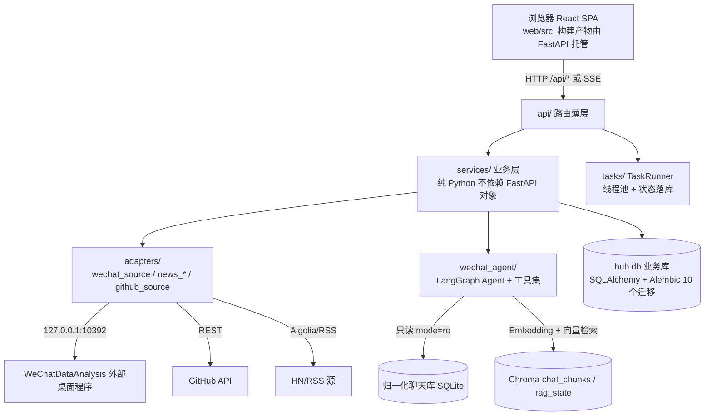
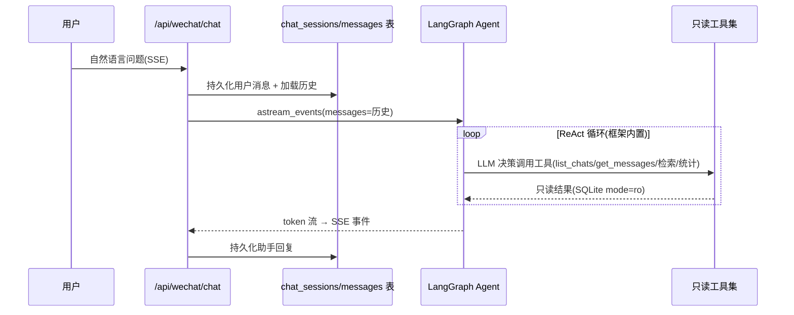
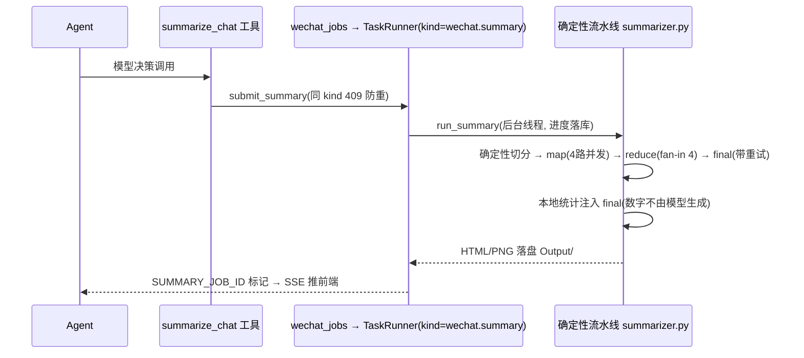

# 项目技术审计报告（面向 AI Agent 应用开发工程师简历）

> 审计对象：`e:\wechat-LangGraph`（个人助手 Personal Hub）
> 审计方式：只读代码审计 + 只读数据库统计 + Git 历史分析 + 实际运行测试套件
> 审计日期：2026-11-07
> 报告性质：**事实核查报告**，不是简历正文。所有结论附证据位置；无法证实者明确标记。

---

## 1. 项目概况与真实性边界

### 1.1 项目是什么

Windows 本地运行的**单用户个人信息与事务管理平台**：FastAPI + React，浏览器访问（127.0.0.1:8620），本地优先。核心 AI 能力是**微信聊天助手**——基于 LangGraph Agent 的群聊问答与群聊日报生成，配套 RAG 语义检索、增量数据同步与人工审核的数据清理。

- 目标用户：开发者本人（单用户，无账号体系，PRD §1.2 明确非目标）。
- 项目性质：**已实际使用的个人系统**（非 Demo）——真实库中已有真实聊天数据（1 个群、7659 条消息，2026-10-27 单日）、14 本书、44 条每日任务、GitHub 同步产生的 1097 条 commit 记录（`data/hub.db` 只读统计，本次审计实测）。
- 代码规模：后端 `app/` 约 6000+ 行（wechat_agent 子包 3234 行）；前端 `web/src` 39 个 ts/tsx 文件 + 8 个测试文件。

### 1.2 已证实的能力清单（以代码为准）

| 能力 | 状态 | 证据 |
|---|---|---|
| LangGraph Agent 对话式问答（SSE 流式、多轮会话持久化） | 已实现 | `app/wechat_agent/agent.py`、`app/api/wechat.py:190` |
| 确定性 map/reduce/final 群聊总结流水线（HTML/PNG 报告） | 已实现 | `app/wechat_agent/chat_tools/summarizer.py:244` |
| RAG 语义检索（Chroma + DashScope Embedding，增量索引） | 已实现 | `app/wechat_agent/normal_tools/rag_store.py` |
| 关键词/语义双路检索 + 结构化统计工具 | 已实现 | `app/wechat_agent/chat_tools/chat_tools.py`、`semantic_search.py` |
| 微信数据增量同步（重叠窗口 + 幂等 + 游标 + 对账） | 已实现 | `app/services/wechat_service.py` |
| 人工审核式数据清理（四表状态机、保护日期、断点续跑） | 已实现 | `app/cleanup/service.py` |
| 技术资讯 TOP10（多源抓取、确定性评分、LLM 批量翻译缓存） | 已实现 | `app/services/news_scoring.py`、`news_translation.py` |
| GitHub 数据同步 + 贡献热力图（REST API、限流重试、游标增量） | 已实现 | `app/adapters/github_source.py`、`app/services/github_service.py` |
| 计划/阅读/备忘/重要信息管理 | 已实现（CRUD 为主） | `app/services/plans_service.py` 等 |
| 每周回顾 Agent | **已实现后被回退** | 提交 `840416e` 实现、`8aa1a6f` 同日渐回退；`app/review_agent/` 仅剩 `__pycache__`，但 hub.db 留有 2 条 weekly_reviews 使用痕迹与迁移 `0009_weekly_review.py` |

### 1.3 真实性边界（必须诚实声明的局限）

1. **数据规模小**：真实聊天数据仅 1 个群、1 天、7659 条消息（只读统计实测）。所有"数千条/天"的描述都基于这一天的真实数据与工具设计上限，不能夸大为"海量数据"。
2. **无性能实测指标**：代码与文档中没有 P50/P95 延迟、召回率、任务成功率等任何基准数据。报告中所有这类指标均属"缺失"。
3. **单人项目、开发周期短**：Git 历史 58 个提交、单一作者、集中在 2026-10-28 ~ 2026-11-07 约 11 天。AGENTS.md 明确是"约束本仓库的所有开发者与 AI 编码助手"，**AI 辅助开发痕迹明显**，个人贡献无法从 Git 区分——简历中的个人职责表述需本人确认。
4. **文档与实际的部分出入**：
   - `Docs/Architecture.md:116` 宣称"每次 LLM/Embedding 调用写 token_usage"，实测 **只有资讯翻译落库**（`app/services/news_translation.py:101`）；总结流水线与 Embedding 仅打印到控制台（`summarizer.py`、`rag_store.py:80`）。hub.db token_usage 表 12 条记录全部为 `news.translate`。
   - 多 Agent 协作、长期记忆、每日简报均为**规划未实现**（`Docs/DEVELOPMENT_PLAN.md`）。
5. **weekly review Agent 被回退**：面试中如被问到"多 Agent"，需主动说明该功能实现后又被撤销（提交 `840416e`/`8aa1a6f`），当前是单 Agent 架构。
6. 无鉴权/无多用户/无网络暴露（设计如此，PRD §1.2），不是"企业级"系统。

---

## 2. 系统架构与关键调用链

### 2.1 分层架构（已实现，与文档一致）

### 2.2 关键调用链

**对话问答链**（`app/api/wechat.py:190` → `app/wechat_agent/agent.py:82`）：

**总结链**（Agent 决策 → 工具 → 后台 job，禁止旁路，决策 D2）：

**同步链**（`app/services/wechat_service.py:207`）：启动外部程序(白名单校验) → 重叠窗口分页拉取(desc+offset 是唯一可用接口) → 快照库幂等 upsert → 归一化(指纹去重) → **两步都成功才推进游标** → 按日对账补录 → Chroma 增量索引。

**清理链**（`app/cleanup/service.py`）：周日生成审核(week_id 幂等) → 只读扫描生成候选 → 人工勾选+确认(生成删除计划明细落库，仍不删) → 后台执行(逐项状态机 validate→三层删除→rag_state 回写，断点可续) → 审计落库。

---

## 3. Agent 架构专项分析

### 3.1 框架与运行机制（已实现事实）

- **框架**：`langchain.agents.create_agent`（langgraph 1.x 入口，返回编译好的 CompiledStateGraph），见 `app/wechat_agent/agent.py:25-88`。是**预置 ReAct 式单 Agent**，节点/条件边由框架内部定义（call_model / tools 节点、"继续调工具还是结束"条件边），项目**没有自定义图节点或自定义状态机**。
- **工具选择**：7 个 `@tool` 函数（`chat_tools.py:279` ALL_TOOLS），工具 docstring 与参数签名直接暴露给 LLM 作为行为契约（代码注释明确"改 docstring = 改模型行为"）。
- **多轮与上下文**：无图内 Checkpointer；会话历史存 hub.db（chat_sessions/chat_messages），每轮把历史消息整体传给 `agent.invoke/astream_events`（`app/api/wechat.py:215`），CLI 模式同理（`agent.py:131`）。
- **系统提示词工程**：静态规则 + 运行时注入本机日期（`agent.py:65` build_system_prompt），解决 LLM 相对日期计算的时区/时钟不可靠问题（注释记录了动机）。
- **人工确认/权限**：Agent 侧无人工中断；权限控制靠**机制而非约定**——所有工具用 SQLite `mode=ro` 物理只读打开（`chat_tools.py:59-67`），即使提示词被注入要求写库也会在 SQLite 层报错。
- **失败处理**：工具内捕获异常并返回**人话错误串**给模型继续对话（`semantic_search.py:66-74` 检索降级建议；`chat_tools.py:247-270` 对 OpenAI 错误族逐类映射：额度 403/限流 429/网络/输出截断/内容审核/总闸）；API 层 SSE 异常落 error 事件（`wechat.py:247`）。

### 3.2 关键设计决策分析

**决策一：问答环节用"提示词驱动的 Agent 自主分批取数"代替代码切分**（`agent.py:41-43` 注释）。

- 一天消息可达数千条，单次工具读取硬上限 1000 条（`chat_tools.py:140-156`），提示词要求模型按小时段多次调用再汇总。
- 这是真实的方案权衡：**省掉了编排代码，但把上下文预算控制的正确性押在模型服从度上**。这是面试中会被追问的点（见 §11 Q1-Q3）。

**决策二：总结不交给 Agent 自由发挥，而是 Agent 只触发确定性流水线**（D2）。

- LLM 决策的环节：是否总结、哪个群、哪个日期。确定性执行的环节：切分（无遗漏无重叠）、map/reduce/final 结构、所有统计数字由本地计算注入（`summarizer.py:227-241`），模型只负责组织语言。
- 这回答"是否真的需要 Agent"：**问答需要（检索路由不可预知），总结不需要自由 Agent（所以退化为工具触发的固定流水线）**。这是项目里最有架构自觉的设计。

**决策三：检索路由交给提示词规则而非训练/分类器**（`agent.py:50-57`）：关键词精确搜索与语义检索**互斥二选一**，语义未命中才允许关键词兜底一次。未见对此规则效果的量化验证（缺失指标）。

### 3.3 Agent 架构的真实局限（诚实清单）

1. 单 Agent、无多 Agent 协作；weekly review Agent 曾被实现又回退。
2. 无图持久化/Checkpoint，会话恢复靠自建表，不能恢复"跑到一半的工具循环"。
3. 无工具调用权限分级（所有工具平权，靠 docstring 约束何时调用）。
4. 无 Agent 执行追踪与效果评测（DEVELOPMENT_PLAN 阶段四，未实现）；LangSmith 追踪配置了但只做了日志收敛与上传重试调优（`tracing_config.py`），未见 trace 分析闭环。
5. 上下文管理是"全量历史重放"，长会话会有 token 膨胀问题，未见截断/压缩策略。

---

## 4. RAG 与数据检索分析

### 4.1 数据流（全部已实现）

原始微信消息（外部桌面程序 API）→ 快照库（原始 JSON 不裁剪，可重放）→ 归一化库（renderType 规则映射消息类型、字段优先级提取正文、指纹去重，`structured_message.py:40-69`）→ Chunking（组合策略，见下）→ Embedding → Chroma。

**Chunking 策略**（`chunking.py:24-27`）：时间间隙 5 分钟切断 + 每 Chunk ≤15 条 / ≤800 字符 + 数量/长度切分时 2 条消息重叠（时间间隙切分不重叠，避免跨间隙噪声）；单条超长消息软约束并入；**Chunk ID = sha1(chat_id|msg_ids) 确定性哈希**——同一批消息永远同一 ID，天然幂等（`chunking.py:46-55`）。另有 content_hash 识别"边界不变但内容变了"的更新场景。

**Embedding/向量库**：DashScope `text-embedding-v4`（1024 维，OpenAI 兼容接口），自实现 Chroma EmbeddingFunction；**实测兼容接口单批上限 10 条**（>10 报 400），代码按 BATCH_SIZE=10 分批（`rag_store.py:48-49`，注释记录实测依据）；Chroma 持久化，cosine 空间，metadata 过滤（chat_id/date）。

**检索**：向量召回（top_k ≤ 50，cosine distance）+ 元数据过滤组合；命中片段携带 msg_ids 回填给 LLM，可用 `get_messages_by_ids` 回溯原文、`count_speakers_by_ids` 做确定性发言统计——**后者免疫 Chunk 重叠造成的重复计数**（`semantic_search.py:119-128`），是一个经过思考的细节设计。

### 4.2 增量与一致性（项目内最有深度的部分）

`rag_store.incremental_index()`（`rag_store.py:269-329`）：

- 每群独立游标（rag_state collection），只处理上次之后的新消息；
- 边界 Chunk 重新切分、与旧文档 ID 对比、删除漂移遗留；**未变化 Chunk 的向量全部复用**（注释说明这是阶段 3.6 的调整，早期版本每次同步全群重建，为避免 Embedding 成本而改）；
- 失败策略：嵌入失败在删除旧索引之前抛出，**旧索引保持可用**，下轮自动重试尾部；
- "总数减少才全群重建"的判定 + 清理后 rag_state 以实际剩余数回写（`cleanup/chroma_access.py:111-130`），并有负面对照测试证明该回写与重建判定的兼容性必要（`tests/test_cleanup_index.py`）。

### 4.3 引入 RAG 解决了什么、代价是什么（有代码证据的分析）

- **解决的问题**：提示词与工具注释明确——"情绪、态度、观点、隐含表达类内容换个说法关键词就搜不到"（`semantic_search.py:41-44` 的例子："是否有人表达过对主播的担忧"可能表现为"早点休息"）。这类查询 LIKE 无法覆盖，是真实的动机证据。
- **代价**：① Embedding API 成本与外部依赖（同步链路里 Embedding 失败会导致索引落后，有降级路径：语义检索失败时工具返回"改用 search_messages 关键词搜索"建议，`semantic_search.py:66-74`）；② 一致性负担——删除场景 Chroma metadata 不支持子串匹配，需客户端解析 msg_ids 逐条判定（`cleanup/chroma_access.py:44-95`），混合 Chunk 保守保留会导致"已删消息文本仍可被检索到"的明示妥协；③ 小数据规模下（7.7k 条/天），LIKE + 分时段全文阅读在多数查询上够用，RAG 的真实收益区间主要在语义类查询。
- **重排序/去重/评估**：无重排序；无 RAG 评估机制（无 Recall@K/Hit@K 任何数据）。这是明确缺失。

---

## 5. 长上下文及 LLM 调用分析

### 5.1 实际数据规模与调用参数

- 实测真实数据：单日单群 7659 条消息（只读统计）。按工具上限设计值：单工具调用最多返回 1000 条/约数万字符进入上下文。
- 模型：DashScope（阿里云百炼）OpenAI 兼容接口，当前默认 `qwen3-vl-plus`，temperature 0.2，总结流水线 max_tokens=8192，翻译 max_tokens=4096（`llm_config.json`、`summarizer.py:145`、`news_translation.py:157`）。模型可经环境变量切换，`llm_config.py` 维护按模型系列的 JSON Mode 思考模式开关矩阵（依据百炼官方清单的正则匹配，`llm_config.py:61-86`）。

### 5.2 上下文管理方案（两套，针对不同环节）

1. **问答环节**：提示词驱动的 Agent 自主分时段取数 + 工具硬上限（§3.2 决策一）。无代码级分片。
2. **总结环节**：确定性 map/reduce（`summarizer.py`）：
   - 切分四参数：500 条 / 24000 字符 / 240 分钟跨度 / 90 分钟硬间隔，每条消息恰好进入一个 Chunk，无截断无重叠；
   - map：4 路线程并发（`ThreadPoolExecutor(max_workers=4)`，`:274`），每 Chunk 一次 JSON Mode 结构化调用；
   - reduce：超过 5 份时按 fan-in 4 逐级合并，直到可进 final；
   - final：固定 Schema 生成报告；**统计数字全部本地计算注入**（`_local_stats`），"杜绝编造"。

### 5.3 真实遇到过的 LLM 问题（有代码注释作证的实测结论）

**问题 A：final 阶段长输入 + JSON Mode 下模型偶发退化**（复读垃圾 token 到输出上限 / 输出非 JSON）。证据：`summarizer.py:302-320` 注释记录"实测同输入成功率约 2/3，重试一次提升到约 8-9 成"，方案为仅对 final 重试一次（map/reduce 不重试以控成本），捕获 `ValueError` 与 `LengthFinishReasonError`。
**问题 B：JSON Mode 在不同 Qwen 系列上行为不一致**（部分系列仅非思考模式支持结构化输出）。方案：按官方清单维护正则名单，调用时动态附加 `enable_thinking=False`（`llm_config.py:97-125`），未知模型保守不加。
**问题 C：异常类层级陷阱**（`LengthFinishReasonError`/`ContentFilterFinishReasonError` 继承自 `OpenAIError` 而非 `APIError`，容易漏捕获刷屏）。方案：逐类映射 + 总闸（`chat_tools.py:235-270`，Git 提交 `3c1fca9` "langsmith报错优化"同期治理）。

### 5.4 成本与缓存

- token_usage 表设计与资讯翻译落库已实现（`_record_usage`），但**总结/Embedding 未落库**（§1.3 第 4 条），所以"全链路成本可分析"目前不成立。已落库的 12 次调用合计输入 6644 / 输出 2817 tokens（hub.db 只读统计）。
- 缓存：资讯翻译结果落库复用（不重复调 LLM）；向量索引增量复用未变化 Chunk；无 LLM 响应缓存。

### 5.5 缺失

无分片一致性评测（跨 Chunk 话题合并质量）、无 token 成本曲线、无超长输出处理策略（仅重试）。

---

## 6. 软件工程与系统设计

以下均为**代码核实过**的能力，附最能体现复杂度的点：

- **前后端分离**：前端仅调 `/api/*`；FastAPI 托管 SPA 构建产物并做 SPA 回退（`main.py:27-41`，API 404 与非 API 回退区分）。
- **任务状态机**：`TaskRunner`（`tasks/__init__.py:35-103`）提交即落库、同 kind 409 防重（进程内锁 + DB 唯一索引双层，`wechat_jobs.py:24-51`）、异常落任务表不静默、**启动钩子把僵尸 pending/running 标记 failed**（`main.py:91-112`）——不依赖进程内锁的跨重启安全。
- **数据库迁移**：Alembic 10 个迁移（0001-0010），模型与迁移一一对应；聊天两库走 PRAGMA user_version 自管理版本（`message_store.py:128-146`）。
- **领域异常体系**：`DomainError` 家族 + API 统一 `{detail:{code,message}}` 映射（`exceptions.py`）。
- **数据安全**：密钥权威在 `~/.personal-hub/.env`（env_bootstrap 加载，仓库零密钥）；聊天库一律 `mode=ro`；文件下载白名单扫描防路径穿越（`wechat.py:132-141`）；笔记上传校验扩展名+文件头签名；日志白名单不落聊天正文。
- **外部集成防御**：统一超时 + 最多 2 次重试；GitHub 适配器按 Retry-After/RateLimit-Reset 等待限流（`github_source.py:82-100`）；微信适配器白名单校验 exe 后启动并轮询就绪（`wechat_source.py:53-107`）。
- **测试**：见 §8。

**体现工程复杂度的核心设计**（非 CRUD）：清理执行的状态机（明细落库→逐项复检→三层删除→回写→审计，断点续跑且重试幂等，`cleanup/service.py:437-534`）、同步的"游标后置"两阶段提交思想、RAG 增量的向量复用与失败不破坏旧索引。**可扩展性受限于单进程单用户设计**（有意为之，PRD §1.2）。

---

## 7. 真实技术难点与解决方案

以下问题均有代码注释、测试或 Git 历史佐证；无佐证的设计动机已标注"推测"。

**技术问题 1：问答环节的上下文爆炸风险**
- 背景/表现：单日消息可达数千条，一次性读入会撑爆上下文且烧 token。
- 方案：工具硬上限 1000 条 + 系统提示词强制分时段取数汇总（`agent.py:49`、`chat_tools.py:155-156`）。
- 曾经考虑的另一条路：代码切分编排（原 wechat-chat-summary 的 chunking 模块角色）——被提示词方案替代，注释明确记录了这一取舍（`agent.py:41-43`）。
- 局限：正确性依赖模型服从提示词，无强制机制（对比总结流水线是代码写死的）。
- 证据：`app/wechat_agent/agent.py:41-62`、`chat_tools.py:140-166`。

**技术问题 2：同步管道的不完整数据问题**
- 背景：外部 API 只有 offset 分页 + 倒序 + 客户端时间过滤，存在迟到消息、同秒消息、分页漂移。
- 方案：重叠窗口（游标-24h）重拉 + `(timestamp, message_id)` 稳定主键幂等 upsert + 游标只在快照与归一化都提交后推进 + 指纹去重 + 同步后按日对账补录（`wechat_service.py:1-14, 93-129, 132-172`）。
- 效果验证：`tests/test_wechat_sync.py`（8 个用例）；`test_multigroup.py`。
- 证据：`app/services/wechat_service.py`。

**技术问题 3：删除操作在"两库 + 向量库"三处的一致性与安全**
- 背景：D4 要求绝不自动删除；Chroma 的 where 不支持子串匹配，metadata.date 不可信（Chunk 跨午夜）；混合 Chunk 无法部分删除。
- 方案：人工勾选+确认 → 删除计划明细持久化 → 执行前三重复检（保护日期/计数一致性/chunk 处置结论）→ 逐层删除（归一化→Chroma→快照）每层落 item 状态、断点可续 → rag_state 以实际剩余数回写。chunk 一律保守：全命中才删，混合/保护/未知一律保留并记录原因（`chroma_access.py:1-12`）。
- 已知的明示妥协：混合 Chunk 保留意味着已删文本仍可能被语义检索命中，UI 明示（注释记录）。
- 证据：`app/cleanup/service.py:258-534`、`app/cleanup/chroma_access.py`；测试 `test_cleanup_protection.py`、`test_cleanup_index.py`、`test_cleanup_reminder.py`。

**技术问题 4：final 阶段结构化输出退化**（§5.3 问题 A）
- 验证方法：注释记录了实测成功率（约 2/3 → 重试后 8-9 成）；注意这是开发者实测记录，非自动化测试基准。
- 证据：`summarizer.py:302-320`。

**技术问题 5：目录迁移的零行为变化保证（D3）**
- 背景：微信模块从 `LangGraph/`+`Tool/` 迁入 `app/wechat_agent/`。
- 方案：基线回归测试对拍——`tests/wechat_ref.py` 双路径导入（迁移前后同一组测试不改代码即可运行）、`test_wechat_baseline.py` 覆盖工具注册与 docstring、chunk 确定性、归一化去重排序、报告渲染转义；归一化脚本丢失后用规则推导重建并与历史库逐行对拍（`test_normalize_rebuild.py`）。
- 证据：`tests/wechat_ref.py`、`tests/test_wechat_baseline.py`、`tests/test_normalize_rebuild.py`、提交 `0b1a4fe`。

**技术问题 6：LangSmith SDK 日志刷屏与弱网上传失败**
- 方案：logging Filter 截断超长记录 + 运行时 monkey-patch 官方常量不可配置的后台上传（读超时 10s→30s、重试 3→5）（`tracing_config.py`）。
- 证据：`app/wechat_agent/normal_tools/tracing_config.py`、提交 `3c1fca9`。

---

## 8. 量化指标及现有证据

### 8.1 已有实测数据（本次审计可复验）

| 指标 | 数值 | 来源 |
|---|---|---|
| 后端测试 | 206 个用例全绿（本次审计实际运行，exit 0，约 68s） | `python -m pytest`（conda agent 环境） |
| 前端测试 | 45 个用例全绿、8 个文件全过（本次审计实际运行，17s） | `web/src/test/`（app/cleanup/github/news/plans/rail/reading/wechat） |
| 真实聊天数据 | 1 群、7659 条（归一化库）、7670 条（快照库）、单日 2026-10-27 | 只读 SQL 统计 |
| 真实生成的总结报告 | 至少 1 份（2026-10-27，HTML+PNG） | `Output/馨馨子钻粉群1/` |
| GitHub 同步数据 | 25 仓库 / 1097 commits / 2 PR；同步任务成功 2 次 | hub.db 只读统计 |
| 资讯数据 | 488 条缓存、27 次刷新任务成功、3 次翻译任务成功 | hub.db 只读统计 |
| LLM 成本记录 | 12 次调用，输入 6644 / 输出 2817 tokens（仅翻译链路） | token_usage 表 |
| 开发过程 | 58 提交 / 单一作者 / 11 天 | git log |

### 8.2 可安全复现的数据

- 测试基线：随时可重跑（隔离临时库，零外网零费用）。
- 各模块数据量：hub.db 只读 count（25 张表）。
- 同步/索引幂等性：`tests/test_wechat_sync.py`、`test_rag_store_compat.py`。

### 8.3 缺失的数据 + 建议实验方案

| 缺失指标 | 实验方案 |
|---|---|
| RAG Recall@K / Hit@K | 从真实群聊人工标注 30-50 个"语义类"查询（态度/情绪/隐含表达）+ 已知答案消息 ID；对比 LIKE 基线与向量召回的 Hit@10。成本：一次 Embedding 构建 + 人工标注半天 |
| 总结质量（覆盖率/忠实度） | 对 3-5 个已生成报告，人工核对话题覆盖率与引用原话的忠实度（quotes 要求原文照抄，可程序化抽检 edit distance）；或构造含已知事件埋点的测试日 |
| final 阶段成功率 | 自动化：同输入跑 30 次 final，统计 JSON 解析成功率（验证注释中"2/3→8-9成"的当前模型下是否仍成立） |
| 工具调用成功率 / 任务成功率 | 已有 tasks 表与错误分类码，写个只读统计脚本即可得出 wechat.summary/sync 的历史成功率 |
| P50/P95 延迟 | 对 /api/wechat/chat（按 500/1000 条消息档）与总结流水线埋点计时；当前完全无计时数据 |
| 单次总结 token 成本 | 在 summarizer 补 usage 落库（小改动），跑 3 个不同消息量级的日期得到成本曲线 |

---

## 9. Git 历史与架构演进

58 个提交、单一作者、2026-10-28 ~ 2026-11-07。阶段清晰：

1. **2026-10-28~11-01 Agent 原始期**：从零实现微信工具集、归一化、LangGraph Agent 雏形、RAG（`8ecf98d` "添加RAG"）、map/reduce 总结、final 重试（`443ca2c`）、LLM 配置外置（`4f266c9`）。提交小而频繁，可见逐日调参过程（注入本机日期 `c4ef326`、输出 token `af162f3`）。
2. **2026-11-02~11-03 Personal Hub 基础框架期**：产品设计 → FastAPI+React+启动器（阶段1）→ 计划/阅读（阶段2）。
3. **2026-11-04~11-05 整合扩展期**：资讯中心（阶段4，期间有"自建聚合改为外部导航"的产品调整 `ba7ed9c`）、微信模块迁入 app/（阶段3，`0b1a4fe`，D3）、三栏工作台与多模块优化、**清理审核（阶段5，`039d7a1`，D4）**。
4. **2026-11-05~11-07 规划调整与数据集成期**：文档重构、`840416e` 实现每周回顾 Agent → **`8aa1a6f` 同日 Revert**（撤销原因未在提交信息中说明——推测为用户方向调整，标记待确认）、GitHub 数据集成（阶段一，`6153590`）、阅读笔记 Markdown、交互精简。

技术债务治理信号：文档体系主动精简（`f915913` 合并 ROADMAP/TEST_PLAN）、"无可清理候选不显示横幅"等防骚扰优化（`db52e7c`）、僵尸任务启动清理。**所有提交为同一作者，AI 辅助开发可能性高（AGENTS.md 即为 AI 编码助手而写），个人独立贡献占比无法从仓库证明。**

---

## 10. 简历候选亮点排名

评分维度（各 5 分）：岗位相关度 / 技术深度 / 个人贡献可证明性 / 成果可信度。

| # | 候选亮点 | 相关度 | 深度 | 可证明 | 可信 | 合计 | 证据 |
|---|---|---|---|---|---|---|---|
| 1 | LangGraph Agent 工具化只读数据访问：docstring 即行为契约 + 物理只读(mode=ro) + 双路检索互斥路由 + 工具内错误治理 | 5 | 4 | 4 | 4 | 17 | `agent.py`、`chat_tools.py`、`semantic_search.py` |
| 2 | 长文本总结：确定性 map/reduce/final + 本地统计防编造 + final 重试（有实测成功率记录）+ JSON Mode 模型矩阵 | 5 | 4 | 4 | 4 | 17 | `summarizer.py`、`llm_config.py` |
| 3 | RAG 增量索引与多存储一致性：确定性 Chunk ID、rag_state 游标、向量复用、失败不破坏旧索引、清理场景三分类保守处置 | 5 | 4 | 4 | 4 | 17 | `rag_store.py:269-329`、`cleanup/chroma_access.py` |
| 4 | 数据管道可靠性工程：重叠窗口 + 幂等 upsert + 游标后置 + 指纹去重 + 按日对账 | 4 | 4 | 4 | 4 | 16 | `wechat_service.py`、`tests/test_wechat_sync.py` |
| 5 | 人工审核清理状态机：Human-in-the-loop、计划明细落库、逐项复检、断点续跑、跨重启僵尸任务治理 | 4 | 4 | 4 | 4 | 16 | `cleanup/service.py`、`tasks/__init__.py`、`main.py:91-112` |
| 6 | LLM 工程细节：结构化输出异常分层治理、相对日期注入、LangSmith 调优 | 4 | 3 | 4 | 3 | 14 | `chat_tools.py:234-270`、`agent.py:65`、`tracing_config.py` |
| 7 | 任务状态机与并发控制（同 kind 409 + 唯一索引 + 进度持久化） | 3 | 3 | 4 | 4 | 14 | `tasks/__init__.py`、`wechat_jobs.py` |
| 8 | 迁移对拍保障（D3 基线回归 + 归一化重建对拍） | 3 | 4 | 4 | 4 | 15（工程亮点，岗位相关度中等） | `tests/wechat_ref.py`、`test_normalize_rebuild.py` |
| 9 | GitHub 数据管道（限流等待重试、游标增量、merge 幂等） | 2 | 3 | 4 | 4 | 13 | `github_source.py` |
| 10 | 资讯抓取/评分/翻译缓存 | 2 | 2 | 4 | 4 | 12 | `news_*.py` |
| 11 | 计划/阅读/备忘 CRUD | 1 | 1 | 4 | 4 | 10 | `services/plans_service.py` 等 |

**最值得写进简历的 3-5 个**：#1 Agent 工具化设计、#2 长上下文总结流水线、#3 RAG 增量与一致性、#4 同步可靠性（或 #5 清理状态机，取决于岗位偏 Agent 安全还是偏数据工程）。

**实现了但简历价值低**：计划/阅读/备忘 CRUD、右侧栏组件、启动器（`.bat/.vbs`）、资讯导航。

**容易被认为是简单 API 封装的**：GitHub 同步（纯 REST 管道，无 LLM）、资讯翻译（一次批量 prompt）。若写，必须带上限流重试与缓存设计细节。

**容易被过度包装、必须避免的表述**：
- "大规模/海量数据处理"（真实数据 1 天 7.7k 条）
- "多 Agent 系统"（单 Agent；weekly review Agent 已回退）
- "企业级安全/权限体系"（无鉴权，是单机个人工具）
- "完整 RAG 评估体系"（不存在）
- "全链路 token 成本监控"（只有翻译链路落库）
- "提升召回率 X%"（无任何对照实验数据）

**最适合深入追问的技术难点**：#2 的 final 退化与重试（有实测故事）、#3 的清理一致性妥协（混合 Chunk 问题）、#1 的"提示词分片 vs 代码分片"权衡、#4 的游标后置设计。

**目前最缺的证据**：所有效果类指标（§8.3）；项目周期与单人开发的客观制约（面试中应主动框定为"个人项目"而非隐瞒）。

---

## 11. 面试官技术追问清单（18 问）

| # | 追问 | 模块 | 考察意图 | 代码证据 | 当前回答依据是否充分 |
|---|---|---|---|---|---|
| 1 | 为什么问答环节用提示词让模型自己分批取数，而不是代码切分后 Map-Reduce？ | Agent 上下文管理 | 判断方案权衡是否真实思考过 | `agent.py:41-49` 注释 | 充分（注释记录了取舍，但要能说出"依赖模型服从度"这一代价） |
| 2 | 模型不按小时段分片、一次要全天数据怎么办？ | 同上 | 探防护机制的边界 | `chat_tools.py:154` 硬上限 | 部分（代码有 1000 条硬上限兜底，但没有"检测到未分片时的纠正"逻辑，需承认） |
| 3 | 分时段各自总结再汇总，话题跨时段被切断/重复怎么办？ | 总结流水线 | 跨分片一致性 | `summarizer.py`（切分无重叠，reduce 才去重） | 部分（reduce 有去重设计，无质量评测数据） |
| 4 | 为什么总结不让 Agent 自由做，非要确定性流水线？（D2 的动机） | 架构决策 | Agent vs Workflow 的判断力 | `summarizer.py:1-10` docstring、`PRD D2` | 充分 |
| 5 | 报告里的数字怎么保证不是模型编的？ | 防幻觉设计 | 对 LLM 可靠性的工程意识 | `summarizer.py:227-241` 本地统计注入 | 充分 |
| 6 | final 阶段重试一次成功率 8-9 成这个数字怎么来的？现在模型换了还成立吗？ | LLM 可靠性 | 验证"实测"是否真实 | `summarizer.py:302-308` 注释 | **不充分**——只有一次历史实测记录，无自动化基准，建议面试前补做 §8.3 实验 |
| 7 | JSON Mode 的思考模式开关矩阵为什么用正则维护？新增模型怎么办？ | LLM 兼容性 | 工程维护性 | `llm_config.py:56-86` | 充分（能讲清百炼官方清单依据与保守默认策略） |
| 8 | 语义检索和关键词检索怎么路由？路由错了会怎样？ | 混合检索 | 检索策略 | `agent.py:50-57`、`semantic_search.py:39-54` | 部分（规则在提示词层，无路由准确率数据） |
| 9 | 怎么证明 RAG 比 LIKE 好？有没有做过对照？ | RAG 评估 | 是否有评估意识 | 全库无评估代码 | **不充分**——必须承认未做，并给出 §8.3 的实验方案（这是当前最大短板） |
| 10 | Chunk ID 用 sha1(msg_ids) 有什么问题？（边界变化导致新 ID、旧向量泄漏） | 向量一致性 | 索引设计 | `chunking.py:46-55`、`rag_store.py:303-312` | 充分（能讲清边界重切 + stale 清理 + 向量复用的闭环） |
| 11 | Embedding 调用失败会发生什么？同步算不算成功？ | 故障处理 | 降级设计 | `rag_store.py:309-328` | 充分（旧索引可用、单群失败隔离、rag_state 兼容） |
| 12 | 删除已确认，执行到一半进程挂了，重试会不会删错？ | 删除安全 | 幂等/事务设计 | `cleanup/service.py:437-534` | 充分（逐项状态机 + 每步幂等 + validated 检查点续跑） |
| 13 | 为什么混合 Chunk 不部分删除？已删文本还能被搜到怎么办？ | 一致性妥协 | 对不完美方案的诚实度 | `chroma_access.py:1-12` 注释 | 充分（UI 明示 + 保守保留是批准的取舍） |
| 14 | 游标为什么在两步提交后才推进？推进了但进程崩了呢？ | 同步可靠性 | 分布式-ish 状态机思维 | `wechat_service.py:93-129` | 充分 |
| 15 | Agent 的提示词注入怎么办？有人让 Agent "删除数据库"会怎样？ | Agent 安全 | 权限设计 | `chat_tools.py:59-67` mode=ro | 充分（机制级只读是亮点答案） |
| 16 | 单 Agent 有没有上下文累积爆炸问题？会话很长时怎么办？ | 上下文管理 | 局限认知 | `wechat.py:215` 全量历史重放 | **不充分**——当前无截断/压缩策略，需承认并给出方案（摘要压缩/滑动窗口） |
| 17 | 数据量扩大十倍（10 个群、每天 7 万条）哪些组件先崩？ | 扩展性 | 容量规划 | 全库 | 部分（能指出 Chroma 全量重建成本、单线程 per-page API、SSE 单实例；但无压测数据） |
| 18 | 为什么 weekly review Agent 做了又删掉？ | 技术决策过程 | 决策的诚实度 | 提交 `840416e`/`8aa1a6f` | **待确认**——仓库未记录撤销原因，需本人准备真实答案 |

---

## 12. 缺失信息与后续验证建议

### 12.1 影响简历真实性的风险清单（按严重程度）

1. **高**：无任何效果/性能量化数据（召回、成功率、延迟、成本）。"做了 RAG/Agent"与"证明了 RAG/Agent 有效"之间有巨大差距，面试官一定会问（§11 Q6/Q9）。建议至少完成 §8.3 中 final 成功率自动化实验与 RAG 对照实验。
2. **高**：个人贡献无法与 AI 辅助开发区分。AGENTS.md、11 天 58 提交、单一作者三者叠加，面试官可能直接问"哪些是你自己写的"。建议准备能白板复述的细节（如混合 Chunk 处置规则、游标比较运算符用 `(ts, msg_id)` 元组的原因）。
3. **中**：文档宣称与实际不符的点（token_usage 全链路记录）——**不要在简历中复述文档宣称，只写代码能证实的**。
4. **中**：weekly review Agent 的撤销原因无记录；如果被问到需有真实、不回避的答案。
5. **低**：数据规模小、单用户、无鉴权——如实框定为"个人本地系统"即可，这些在 Agent 岗位不构成减分，夸大才构成。

### 12.2 补证据的优先级建议

1. final 结构化输出成功率自动化实验（半天，验证注释中的实测结论在当前模型下成立）；
2. RAG vs LIKE 小规模对照评测（1 天，30-50 查询）——把"引入 RAG 的动机"从注释升级为数据；
3. summarizer 补 usage 落库，跑 3 个量级得到 token 成本曲线（半天）；
4. 为 §11 Q2/Q16 准备诚实回答 + 改进方案（这两个是当前架构公认的最薄弱点）。

---

*本报告所有代码位置以 2026-11-07 工作区状态为准；数据库统计均为 `mode=ro` 只读查询；测试套件为审计时实际运行结果（后端 206 用例全绿）。*
